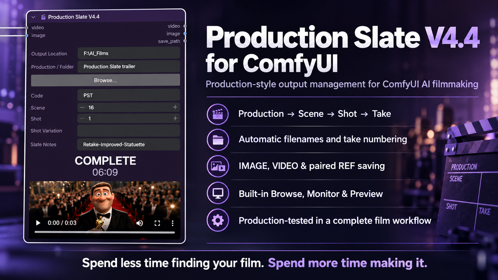
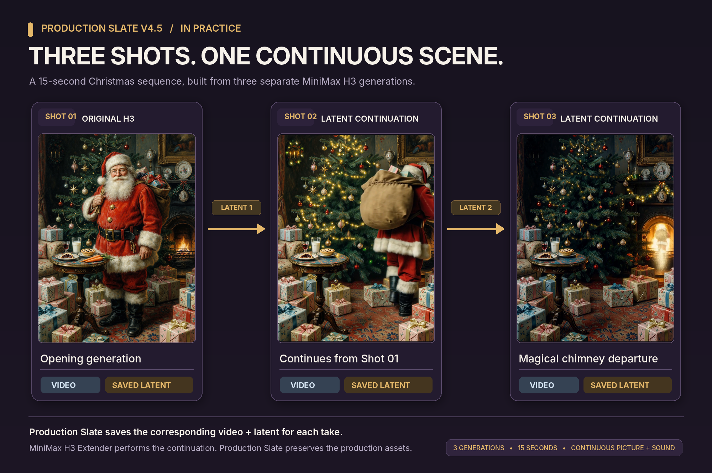

# 🎬 Production Slate V4.5 (development) for ComfyUI

**Spend less time finding your film. Spend more time making it.**



> **Development build — not yet released.** The current public version remains **V4.4** on [`main`](https://github.com/cogfilms-3D/ComfyUI-ProductionSlate). This README documents the tested V4.5 development branch, [`development/v4.5-load-latent`](https://github.com/cogfilms-3D/ComfyUI-ProductionSlate/tree/development/v4.5-load-latent).

Production Slate is a production-output node for ComfyUI designed for AI filmmaking.

It organises generated images, videos, audio and supported latents into a clear production structure using:

**Production → Scene → Shot → Take**

The unified saver sits near the end of a ComfyUI workflow and accepts compatible **IMAGE**, **VIDEO**, **AUDIO** and **LATENT** inputs. The separate **Production Slate — Load Latent** companion node reads saved Production Slate latents from their existing locations.

---

## Getting Started — Video Tutorial

**Production Slate — Organising Your AI Film for ComfyUI**

A short practical walkthrough showing how to replace the basic save node, organise a production by Scene and Shot, use automatic Take numbering, follow render progress, and find the resulting image and video files.

▶️ **Watch on YouTube:** https://youtu.be/8nfZ-741PJ4

---

## V4.5 demonstration — Three shots, one continuous scene

**Three separately generated AI shots. One continuous 15-second Christmas film.**

This real-production demonstration shows how **saving the latent with each video take** enables subsequent latent-based shot continuation. The opening shot was generated using MiniMax H3. The next two shots were continued from saved H3 latents using the **[MiniMax H3 Extender](https://github.com/pmhaidn/ComfyUI-Minimax-H3-Extender)**. The shots were assembled in DaVinci Resolve Studio, with natural continuity of the character, room, ambient sound and background music.

**V4.5 remains in development; no new public release has been made.**



**Watch the 15-second film below (GitHub-hosted video):**

https://github.com/user-attachments/assets/ef2886a8-f65e-4f3e-9f5e-754cf683a971

**[▶ Watch the completed 15-second Christmas demonstration on YouTube](https://youtube.com/shorts/ke6t-xqV7oY)**

In this example, **Production Slate V4.5 saved the videos and their corresponding latents** with matching production, scene, shot and take identities. The H3 Extender performed the actual continuation; Production Slate organised and saved the resulting assets.

### V4.5 — Supported latent save formats

| Format selection | Extension | Typical use |
| --- | --- | --- |
| **Auto Detect** (single tensor) | `.latent` | Standard ComfyUI image latents |
| **Auto Detect** (nested tensor) | `.avlatent` | Nested audio/video latents, including tested LTX 2.5 output |
| **H3 Motion Context** (explicit selection) | `.safetensors` | Tested MiniMax H3 video/audio motion-context pairs |

The formats are **not interchangeable**. Auto Detect checks latent data shape, not the source model: **select H3 Motion Context explicitly** when a compatible H3 Extender file is required. The saver preserves supported auxiliary latent fields for recovery by the Production Slate loader; third-party loaders may not restore these fields.

**Tested live:** standard ComfyUI `.latent`, LTX 2.5 `.avlatent`, and MiniMax H3 `.safetensors` were each saved, loaded, and saved again. These tests confirm round trips, **not** every downstream continuation or decoding workflow.

*This film is a production demonstration, not a promise of seamless continuation in every model or generation.*

---

## Why Production Slate?

AI filmmaking quickly produces large numbers of images, videos, variations and takes.

Without a consistent production structure it becomes increasingly difficult to answer simple questions such as:

- Which scene did this shot belong to?
- Which take was this?
- Where are the other versions?
- Which image belongs with this video?
- Where did I save that shot?

Production Slate applies a simple film-production style structure automatically.

---

## Features

### Unified IMAGE, VIDEO, AUDIO and LATENT saving

The **🎬 Production Slate V4.5** saver accepts optional IMAGE, VIDEO, AUDIO and LATENT inputs, individually or in supported combinations. Connect **at least one**.

- Existing IMAGE-only, VIDEO-only and paired VIDEO + IMAGE functions are retained.
- AUDIO-only saves are supported, as is AUDIO saving alongside images or video.
- Supported LATENT files can be saved with matching production and take identities, or as LATENT-only takes.

VIDEO and IMAGE outputs pass through as before; the new AUDIO output passes the original audio onward without alteration. **There is no LATENT output on the saver**; use the separate loader for a LATENT output.

---

### Automatic production folder structure

Example:

```text
My Film
└── SC001
    ├── Images
    └── Video
```

Additional scenes are created automatically:

```text
My Film
├── SC001
├── SC002
├── SC003
└── ...
```

---

### Automatic filenames and take numbering

Example video filename:

```text
KR_SC001_SH023_261004_007.mp4
```

Example image filename:

```text
KR_SC001_SH023_261004_007.png
```

Production Slate scans the existing production folder and automatically selects the next available take number.

---

### Paired VIDEO + reference IMAGE

When VIDEO and IMAGE are connected together, Production Slate saves both using the same take number.

Example:

```text
KR_SC001_SH023_261004_007.mp4
KR_SC001_SH023_261004_REF_007.png
```

The VIDEO remains the primary production asset.

The companion REF image can be useful for:

- shot thumbnails
- reference frames
- continuation shots
- visual shot identification

---

### Larger Production folder browser

The unified saver now opens a separate, larger folder-selection dialog, based on the tested Load Latent browser. It includes:

- Drive buttons and a browsable **DEFAULT** ComfyUI output location.
- Editable folder path, **Go**, **Back** and **Up** navigation.
- Distinct **Select Output Location** and **Select Production Folder** actions.
- Visible but unavailable/unselectable non-writable folders, where reported by the backend.
- A lighter-grey **Browse** button, consistent across the Production Slate node family.

**Select Output Location** changes the destination root without replacing Production / Folder. **Select Production Folder** sets both its parent Output Location and its folder name, preserving automatic/manual Code behaviour.

The browser is independent of VideoHelperSuite.

---

### Audio saving and preview

An optional AUDIO input saves to `Production / SCxxx / Audio` using the usual shot and take naming.

| Audio format | Save choice |
| --- | --- |
| FLAC | Lossless |
| WAV | PCM |
| MP3 | 320 kbps |

The saver includes an in-node waveform with duration information, a playback control and scrubbing, plus AUDIO pass-through. It can save an audio batch as consecutive takes. When AUDIO accompanies image/video, the file identities are coordinated where applicable.

Each audio file receives a **same-stem `.json` sidecar** containing production details and the workflow/prompt metadata available from ComfyUI. This is **not** an embedded ComfyUI workflow in the audio file and is **not** a Plenio release record. To recover a ComfyUI workflow, extract `extra_pnginfo.workflow` from the sidecar, save that object as a separate `.json` file, then use ComfyUI's **File → Open**. Recovery depends on the metadata originally supplied.

---

### LATENT saving and the Load Latent companion

The saver's optional LATENT input stores supported latents **alongside the associated primary asset**, with matching filename stem/take; it does **not** create a separate Latents folder. A LATENT-only save goes to **Images** for standard image-shaped samples or **Video** for nested/video-shaped samples. A latent associated with AUDIO-only output is stored in the **Audio** folder.

The saver's **Latent Format** menu provides **Auto Detect**, **ComfyUI Standard (.latent)**, **AV Nested (.avlatent)** and **H3 Motion Context (.safetensors)**.

The separate **🎬 Production Slate — Load Latent** node:

1. Opens its own large browser to select a saved file on a local drive, without copying it to `ComfyUI/input`.
2. Loads supported **Production Slate V4.5** `.latent`, `.avlatent` and `.safetensors` files.
3. Exposes a **LATENT** output for downstream nodes.

The filename extension alone does **not** guarantee compatibility. The loader requires Production Slate's saved format metadata; arbitrary third-party safetensors/latent files may be rejected. It does not decode images/video, perform sampling or automatically start continuation.


---

### Automatic production code

The **Code** field can be generated automatically from the Production / Folder name.

Example:

```text
The King Returns
```

may generate:

```text
KR
```

You can also enter your own code manually.

Clearing the Code field returns it to automatic mode.

---

### Scene, Shot and Shot Variation

Production Slate provides dedicated fields for:

- Production / Folder
- Code
- Scene
- Shot
- Shot Variation
- Slate Notes

These values remain with the workflow and help maintain consistent production organisation.

---

### Render monitor

Production Slate V4.4 includes an integrated execution monitor.

Typical states include:

```text
READY
PROCESSING
GENERATING
SAVING
COMPLETE
```

The monitor can also report:

```text
INTERRUPTED
ERROR
```

During generation it displays ComfyUI's native generation progress together with an elapsed-time counter.

---

### Image preview

IMAGE-only workflows display the generated image directly inside Production Slate.

The native pixel resolution is displayed beneath the preview.

VIDEO and paired workflows continue to use ComfyUI's normal video preview.

---

## Installation — V4.5 development build

The public repository's default `main` branch remains **V4.4**. To install the tested **V4.5 development build**:

1. **Back up** your working `ComfyUI-ProductionSlate` custom-node directory and any locally edited files.
2. On GitHub, open the [V4.5 development branch](https://github.com/cogfilms-3D/ComfyUI-ProductionSlate/tree/development/v4.5-load-latent), choose **Code → Download ZIP**, and extract the **complete** branch contents. Alternatively, clone that branch using the command below.
3. Install the complete `ComfyUI-ProductionSlate` directory under your active `ComfyUI/custom_nodes/` location. Do not mix new frontend files with an older backend or overwrite a working installation without a backup.
4. Restart ComfyUI, then refresh the browser (use **Ctrl+Shift+R** if the old frontend is cached).
5. Search in ComfyUI for **🎬 Production Slate V4.5** and **🎬 Production Slate — Load Latent**.

```bash
git clone --branch development/v4.5-load-latent https://github.com/cogfilms-3D/ComfyUI-ProductionSlate.git
```

Run that command **inside your active ComfyUI `custom_nodes` directory** when installing afresh; do not clone over an existing folder. Existing installations should be backed up and updated deliberately. The folder contains the saver, companion latent loader, backend modules and `web/` browser scripts.

**Requirements:** A compatible ComfyUI installation with its normal Python dependencies. Development testing was performed on **ComfyUI 0.41.3 (Nodes 2)**. Production Slate's browser does **not** require VideoHelperSuite. No special audio generator, latent model or H3 Extender is required to install Production Slate itself; specialised **downstream** workflows may require their own nodes/models.

### Saver inputs

| Input or setting | Function |
| --- | --- |
| VIDEO | Optional completed ComfyUI video |
| IMAGE | Optional image or reference frame |
| AUDIO | Optional ComfyUI audio; choose FLAC, WAV or MP3 |
| LATENT | Optional supported latent payload; choose a format or Auto Detect |
| Output Location; Production / Folder | Destination and production identity |
| Code; Scene; Shot; Shot Variation; Slate Notes | File identity and production notes |

At least one media input (VIDEO, IMAGE, AUDIO or LATENT) must be connected.

### Saver outputs

- **VIDEO**, **IMAGE** and **AUDIO** — original input media passed through when connected.
- **save_path** — the primary saved output path.

### Companion loader

- **latent_path** — choose a previously saved Production Slate V4.5 latent using **Browse latent file…**.
- **LATENT output** — reconstructed saved payload for compatible downstream nodes.


---

## Example production structure

```text
AI_Films
└── The King Returns
    ├── SC001
    │   ├── Images
    │   │   ├── KR_SC001_SH001_261017_001.png
    │   │   └── KR_SC001_SH002_261017_REF_001.png
    │   ├── Video
    │   │   ├── KR_SC001_SH002_261017_001.mp4
    │   │   └── KR_SC001_SH002_261017_001.safetensors
    │   └── Audio
    │       ├── KR_SC001_SH003_261017_001.flac
    │       └── KR_SC001_SH003_261017_001.json
    └── SC002
        ├── Images
        └── Video
```

In this example, the H3 latent sits beside the corresponding video take; the audio `.json` file is its workflow/production metadata sidecar.


---

## Compatibility

- **V4.5 development testing:** ComfyUI **0.41.3**, using the Nodes 2 interface.
- The previously released **V4.4** was field-tested across ComfyUI 0.37.x–0.38.2.
- Earlier Production Slate IMAGE 004-C and VIDEO 004-C workflows retain the existing migration support. Always retain backups of important workflows when changing versions.
- The Production Slate browser requires **no VideoHelperSuite** runtime dependency.
- The new loader has been tested with Production Slate-saved standard, LTX 2.5 AV, and H3 Motion Context latents; compatibility with arbitrary latent files and third-party continuation workflows is **not guaranteed**.
- Audio playback depends on format support in the user's browser. Source AUDIO pass-through is unmodified; MP3 encoding is lossy.


---

## Production tested

Production Slate V4.4 was tested not only through development regression tests but during the complete production of a short promotional film.

That production included:

- script and shot breakdown
- image generation
- video generation
- multiple takes
- paired reference images
- shot selection
- scene organisation
- final editing in DaVinci Resolve

The experience of using Production Slate throughout a complete production has also generated ideas for future versions.

---

## Future ideas (not included in this development build)

Possible later work includes simpler one-click restoration of workflows from audio sidecars, additional production metadata/lineage, and optional support for attaching user-supplied score or metadata files. These are **not current V4.5 features** and have no committed release schedule.

The completed audio and latent feature requests were developed from community feedback: [Issue #2 — LATENT](https://github.com/cogfilms-3D/ComfyUI-ProductionSlate/issues/2) and [Issue #3 — AUDIO](https://github.com/cogfilms-3D/ComfyUI-ProductionSlate/issues/3).


---

## Version

**Production Slate V4.5 — tested development build.**

**V4.4 remains the latest public release** until the development branch is reviewed and merged.

---

## Licence

Production Slate is released under the MIT License.

See [LICENSE](LICENSE).

---

## Author

**Colin Litster**

---

## Trailer and tutorials

Watch the Production Slate V4.4 launch trailer on YouTube (still relevant to the unified saver):

https://youtube.com/shorts/5lPz9jyEo34?feature=share

More tutorials and development updates will follow.

---

**Spend less time finding your film. Spend more time making it.**
